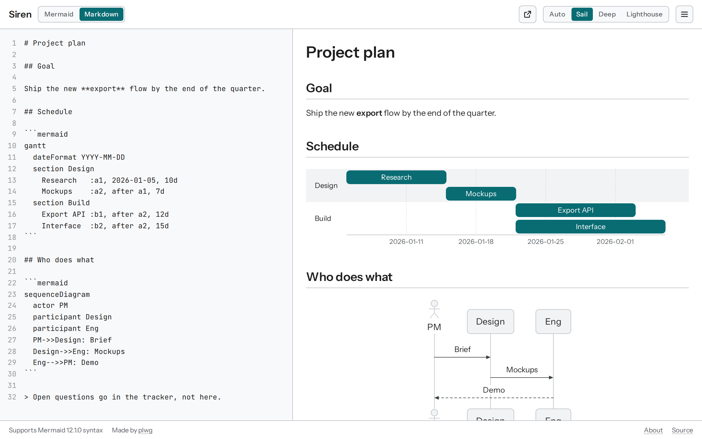

# Siren

Write Mermaid diagrams, or Markdown documents with diagrams in them, and see them drawn as you type. Private, and works offline.

**Live at https://plwg.github.io/siren/**



- **Two modes:** one Mermaid diagram, or a Markdown document with any number of ```` ```mermaid ```` blocks.
- **Share by link or QR code.** Your work is compressed into the link; no server ever sees it.
- **Export** diagrams as SVG, PNG or a copied image, and documents as PDF or `.md`.
- **Private and offline.** No accounts or tracking, and shared links can't load images or run scripts.
- **Themes:** Sail (light), Deep (dark), Lighthouse (high contrast), or Auto.

Rendered by [Pele](https://github.com/obsidianmd/pele) and [Marked](https://marked.js.org). See the **[guide](docs/guide.md)** for every feature and how Siren handles untrusted links.

## Develop

Requires [Bun](https://bun.sh).

```sh
bun install
bun run dev          # local dev server
bun run check        # lint, typecheck, test and build: run before committing
bun run format       # Biome: fix formatting and import order
bun run screenshots  # rebuild the screenshots, link-preview image and touch icon
                     # (first: bunx playwright-core install chromium)
```

Pushing to `main` builds and deploys to GitHub Pages via `.github/workflows/pages.yml`.

## License

[MIT](LICENSE). Pele, Marked, the fonts and other dependencies keep their own licenses.
