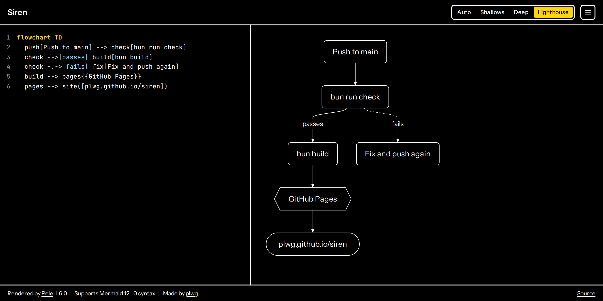
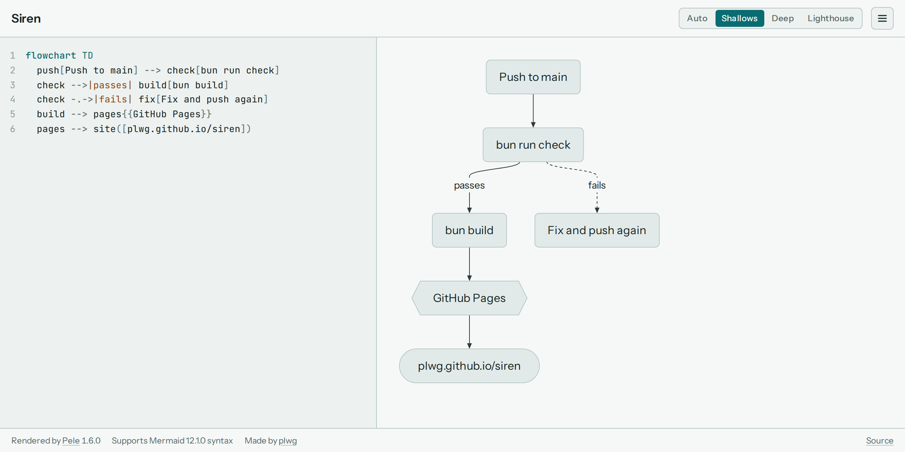
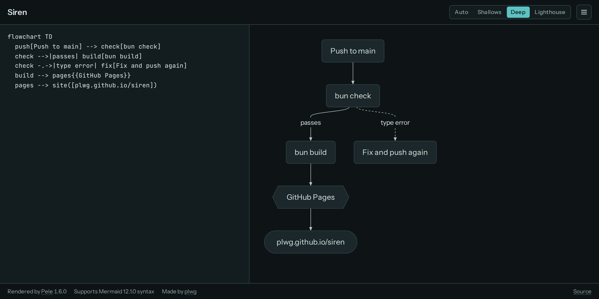

# Siren

Render Mermaid diagrams in the browser with [Pele](https://github.com/obsidianmd/pele).

Live at https://plwg.github.io/siren/



**Lighthouse**, the high-contrast theme: pure black and white with a single signal yellow, heavier strokes and strong focus rings. **Auto** picks it when your system asks for more contrast.

<table>
  <tr>
    <td valign="top"></td>
    <td valign="top"></td>
  </tr>
  <tr>
    <td>Shallows (light)</td>
    <td>Deep (dark)</td>
  </tr>
</table>

- Type Mermaid on the left; the diagram renders on the right.
- On phones, **Code** and **Diagram** tabs show one at a time at full height; the theme switcher and credits move into the ☰ menu.
- The diagram is saved in the URL hash, so a link always carries it.
- Themes: **Shallows** (light), **Deep** (dark), **Lighthouse** (high contrast), or **Auto** to follow the system. Add `?theme=light|dark|contrast` to a link to force one.
- The ☰ menu holds sharing and export:
  - **Copy link** opens the editor with the diagram; **Copy view link** shows only the diagram, in the theme you picked, with an **Edit in Siren** button to open it in the editor.
  - **Copy image** puts a PNG on the clipboard to paste into documents; **SVG** and **PNG** download files.
  - Exports ignore the editor theme. Choose **Sea** or **Neutral** colors, **Light** or **Dark**, and a **Clear** or **Solid** background. Text is set in Arial so it fits in any document app.

## Security

Anyone can craft a Siren link, so diagrams are treated as untrusted:

- [Pele](https://pele.run/security) draws labels as text, drops `click` callbacks, and blocks `javascript:` and `data:` links.
- A Content Security Policy lets only Siren's own scripts run and blocks loading anything from other sites. `bun run build` fails if the inline theme script and its hash in the policy drift apart; `bun scripts/check-csp.ts --write` updates the hash.
- Diagram images are not loaded, so a shared link can't track who views it. Each shows as a dashed placeholder, and a warning says so. Icons (such as `fa:fa-car`) aren't bundled; the warning names them.
- Diagram links are drawn in the accent color with underlined labels, ask before opening, and show where they really go. Exports contain no links or images.
- Fonts are self-hosted, so viewing Siren sends nothing to a font host. The diagram itself lives after the `#` in the URL and is never sent to any server.
- GitHub Actions are pinned to commit hashes, and Dependabot proposes updates.

Siren runs on `plwg.github.io`, which it shares with any other GitHub Pages sites under that account. It stores only theme and export preferences.

## Develop

Requires [Bun](https://bun.sh).

```sh
bun install
bun run dev        # local dev server
bun run typecheck
bun run lint       # Biome: lint and formatting check
bun run format     # Biome: fix formatting and import order
bun run check      # lint, typecheck, test and build: run before committing
bun run build      # outputs to dist/
```

Pushing to `main` builds and deploys to GitHub Pages via `.github/workflows/pages.yml`.
