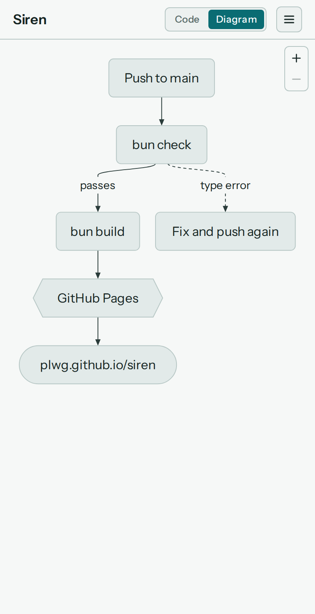
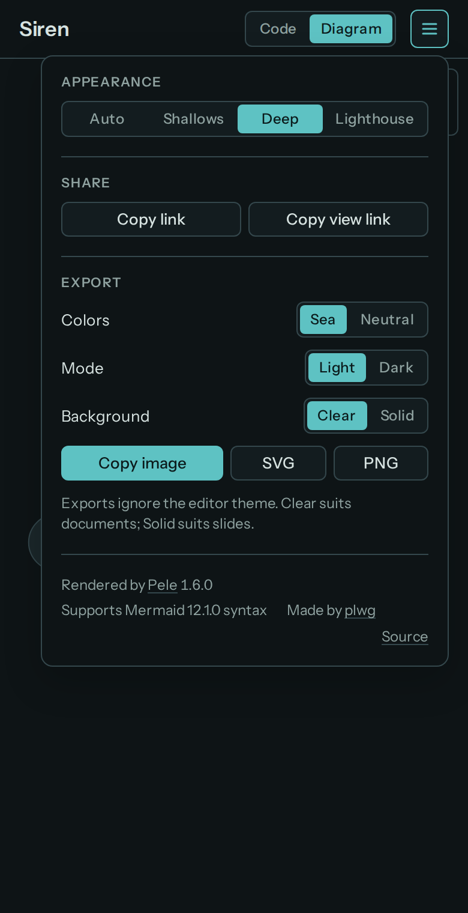

# Siren

Render Mermaid diagrams in the browser with [Pele](https://github.com/obsidianmd/pele).

Live at https://plwg.github.io/siren/

<picture>
  <source media="(prefers-color-scheme: dark)" srcset="docs/screenshots/desktop-dark.png">
  
</picture>

<table>
  <tr>
    <td valign="top"></td>
    <td valign="top"></td>
    <td valign="top"></td>
  </tr>
  <tr>
    <td>Lighthouse, the high-contrast theme</td>
    <td>Phone: Diagram tab</td>
    <td>Phone: ☰ menu</td>
  </tr>
</table>

- Type Mermaid on the left; the diagram renders on the right.
- On phones, **Code** and **Diagram** tabs show one at a time at full height; the theme switcher and credits move into the ☰ menu.
- The diagram is saved in the URL hash, so a link always carries it.
- Themes: **Shallows** (light), **Deep** (dark), **Lighthouse** (high contrast), or **Auto** to follow the system. Add `?theme=light|dark|contrast` to a link to force one.
- The ☰ menu holds sharing and export:
  - **Copy link** opens the editor with the diagram; **Copy view link** shows only the diagram, in the theme you picked.
  - **Copy image** puts a PNG on the clipboard to paste into documents; **SVG** and **PNG** download files.
  - Exports ignore the editor theme. Choose **Sea** or **Neutral** colors, **Light** or **Dark**, and a **Clear** or **Solid** background. Text is set in Arial so it fits in any document app.

## Develop

Requires [Bun](https://bun.sh).

```sh
bun install
bun run dev        # local dev server
bun run typecheck
bun run build      # outputs to dist/
```

Pushing to `main` builds and deploys to GitHub Pages via `.github/workflows/pages.yml`.
