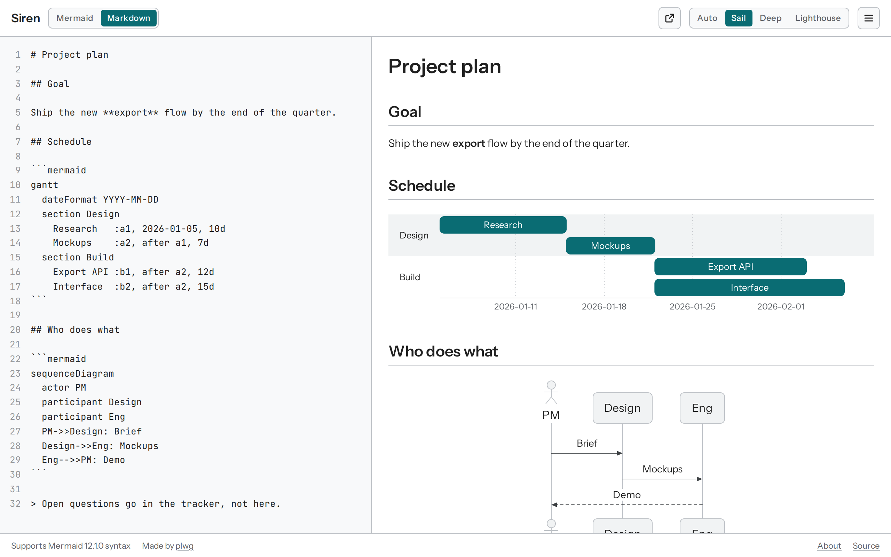
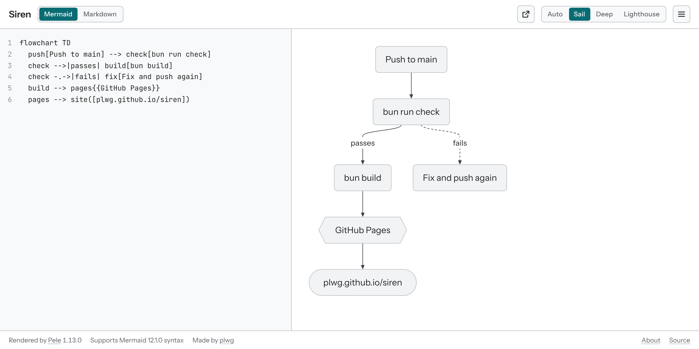
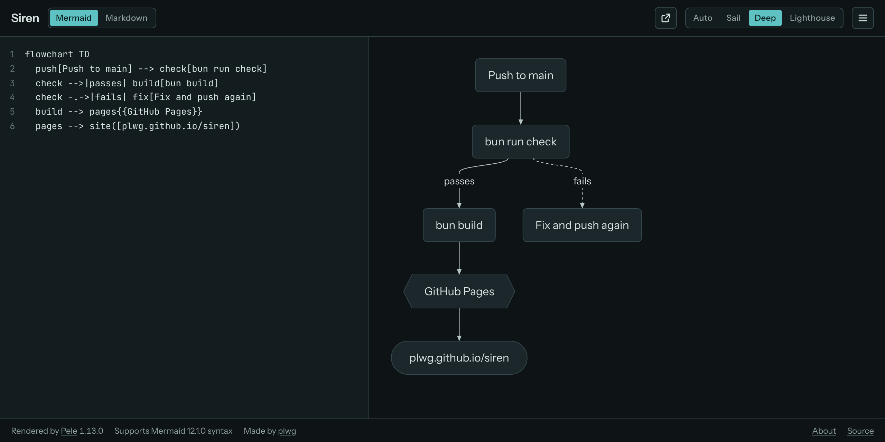
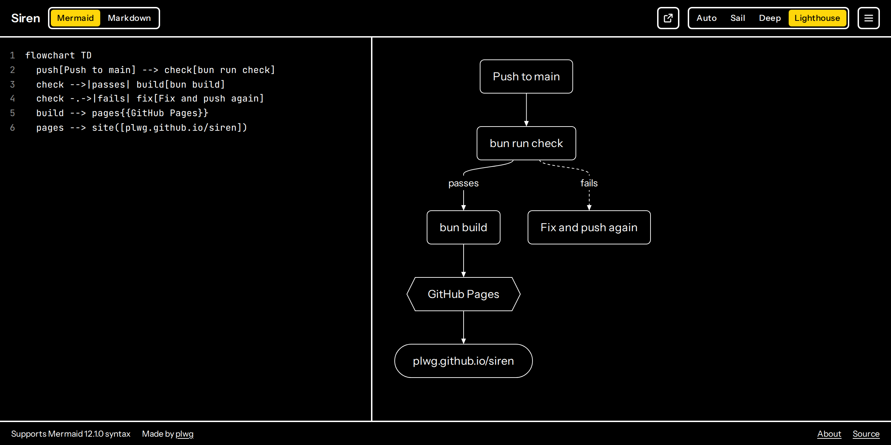

# Siren guide

Everything Siren does, in detail. For a quick overview, see the [README](../README.md).



## Writing

- Click **Siren** in the header for a blank editor; Back returns to what you had before.
- Type on the left; it renders on the right. The editor numbers lines and marks the line with an error.
- On wider screens, drag the divider between the editor and the preview to resize them (arrow keys work when it's focused; double-click resets).
- On phones, **Code** and **Diagram** (or **Document**) tabs show one at a time at full height; the mode and theme switchers and the credits move into the ☰ menu.

## Two modes

Switch modes beside the name (in the ☰ menu on phones):

- **Mermaid**: the text is one diagram. A pasted ```` ```mermaid ```` block loses its fences.
- **Markdown**: the text is a GitHub-flavored Markdown document (headings, lists, tables, task lists, footnotes), and each ```` ```mermaid ```` block in it is drawn as a diagram. A broken diagram shows its error in place, and the editor marks its line. Only diagrams that changed are drawn again, so long documents stay quick to edit. The editor and the preview scroll together, whichever you scroll; on phones, switching between Code and Document keeps your place. A pasted ```` ```mermaid ```` block keeps its fences.
- A document with two or more headings gets a contents button at the top right of the preview. Point at it, or click it on a touch screen, to list the headings; the one you're reading is marked, and choosing one scrolls the preview there. From the keyboard, Tab to the button and press Enter.
- Footnotes work as on GitHub: write `[^1]` in the text and `[^1]: The note.` anywhere in the document. Notes are numbered in the order they're referenced and listed at the end; click a number to jump to its note, and ↩ to jump back.

Each mode keeps its own text: switching shows the other mode's text and changes neither. After a reload, the mode not in the link picks up what you last wrote in it. Back undoes a switch.

## Links

- The diagram or document is saved in the URL after `#`, compressed, so a link always carries it. The link records the mode (`#d.` for a diagram, `#m.` for a document); older links open as diagrams.
- Prose compresses to about six link characters per ten typed, so a long document makes a long link. Siren reads links of up to 200 KB of text, and opens Markdown files up to the same size so that every document survives a reload. Chat and email apps may cut very long links short; send the `.md` file instead.
- Once the page has loaded, Siren needs no network: every diagram type, Markdown, the QR code and exports are in the page, so it keeps working offline.

## The ☰ menu

The menu shows what suits the mode.

- **Share**
  - **Copy link** opens the editor with your work; **Copy view link** shows only the preview, in the theme you picked, with an **Edit in Siren** button to open it in the editor.
  - **QR code** shows a scannable code of the view or editor link, to open it on a phone; it can be downloaded as a PNG. Long documents are too long for a QR code, and Siren says so.
- **Export**, in Mermaid mode
  - **Copy image** puts a PNG on the clipboard to paste into documents; **SVG** and **PNG** download files.
  - Exports ignore the editor theme. They use plain greys with a blue accent. Choose **Light** or **Dark** and a **Clear** or **Solid** background. Text is set in Arial so it fits in any document app.
- **Export**, in Markdown mode
  - **PDF** opens the browser's print dialog (choose Save as PDF): only the document, in light colors whatever the theme, named after its first heading. Text stays selectable and diagrams stay sharp.
  - **Markdown file** downloads the text as `.md`.
- **Diagrams** or **Documents**
  - Start from an example of every diagram type Pele draws, from flowcharts and sequence diagrams to Wardley maps and Venn diagrams; or release notes and a project plan.
  - **Open Markdown file…** (Markdown mode) opens a `.md` file from your device. It is read in the browser and sent nowhere; the current document is kept in Recent, and Undo brings it back.
  - Recent work in the current mode, kept only in this browser.

## Themes

**Sail** (light), **Deep** (dark), **Lighthouse** (high contrast), or **Auto** to follow the system. Add `?theme=light|dark|contrast` to a link to force one.

**Lighthouse** is pure black and white with a single signal yellow, heavier strokes and strong focus rings. **Auto** picks it when your system asks for more contrast.

<table>
  <tr>
    <td valign="top"></td>
    <td valign="top"></td>
    <td valign="top"></td>
  </tr>
  <tr>
    <td>Sail (light)</td>
    <td>Deep (dark)</td>
    <td>Lighthouse (high contrast)</td>
  </tr>
</table>

## Security

Anyone can craft a Siren link, so diagrams and documents are treated as untrusted:

- [Pele](https://pele.run/security) draws labels as text, drops `click` callbacks, and blocks `javascript:` and `data:` links.
- Markdown is rendered by [Marked](https://marked.js.org), with footnotes by [marked-footnote](https://github.com/bent10/marked-extensions/tree/main/packages/footnote), with raw HTML shown as text, links kept only for `http`, `https`, `mailto` and `tel`, and images replaced by a placeholder naming them. Footnote links stay within the page and never change the address, which holds the document.
- A Content Security Policy lets only Siren's own scripts run and blocks loading anything from other sites. `bun run build` fails if the inline theme script and its hash in the policy drift apart; `bun scripts/check-csp.ts --write` updates the hash.
- Images are not loaded, so a shared link can't track who views it. Each shows as a dashed placeholder, and a warning says so. Icons (such as `fa:fa-car`) aren't bundled; the warning names them.
- Links are drawn in the accent color, ask before opening, and show where they really go. Diagram exports contain no links or images.
- Fonts are self-hosted, so viewing Siren sends nothing to a font host. Your work lives after the `#` in the URL and is never sent to any server.
- GitHub Actions are pinned to commit hashes, and Dependabot proposes updates.

Siren runs on `plwg.github.io`, which it shares with any other GitHub Pages sites under that account. In this browser it stores your theme and export preferences and your recent work, which **Clear recent** removes.
